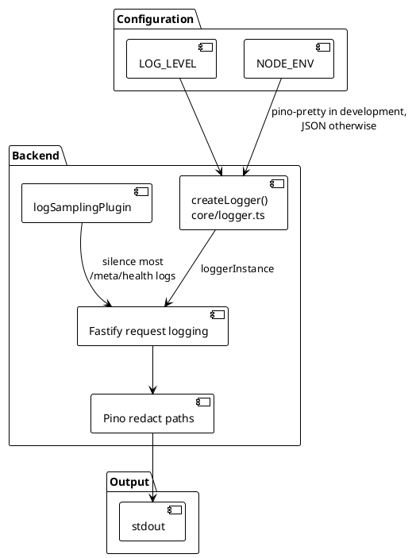
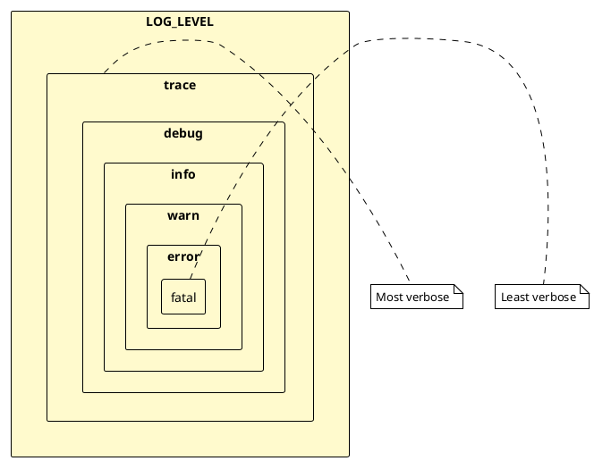
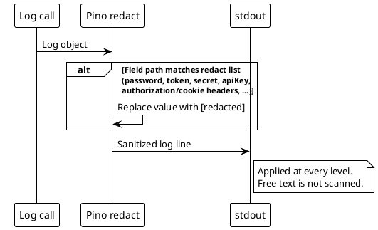
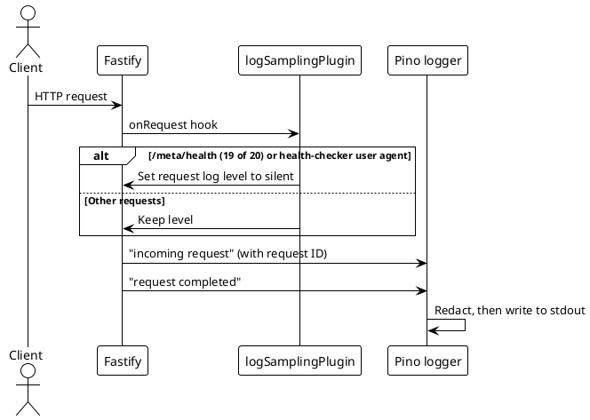

# Logging Configuration

> [!abstract] Overview
> The Watchman backend logs with **Pino** through Fastify (`apps/backend/src/core/logger.ts`). Logs go to stdout. Credentials are redacted. Two environment variables control the output: `LOG_LEVEL` and `NODE_ENV`.

> [!info] Removed variables
> `LOG_ENABLED` and `LOG_REQUESTS` belonged to the old Express backend. The current backend does not read them. (The frontend has its own `VITE_LOG_ENABLED` switch for browser console logging.)

## Environment Variables

### LOG_LEVEL

**Default:** `info`

Minimum Pino level to output, validated by the Zod schema in `apps/backend/src/config/env.ts`. Levels, from least to most verbose: `fatal`, `error`, `warn`, `info`, `debug`, `trace`.

```bash
# In apps/backend/.env.local
LOG_LEVEL=warn
```

### NODE_ENV

**Default:** `development`

- `development`: human-readable, colorized output through `pino-pretty`
- `production` or `test`: one JSON object per line on stdout

## Output and Volume

- Logs go to stdout only. The backend writes no log files. Use your process manager to collect them (for example `journalctl` for systemd or `pm2 logs`). The desktop app captures the backend output in its own log file.
- Fastify logs each request and response, with a request ID it generates per request.
- `logSamplingPlugin` keeps volume down: only 1 in 20 `/meta/health` requests is logged, and requests from common health-checker user agents (`ELB-HealthChecker`, `kube-probe`, `GoogleHC`) are not logged.
- Startup background issues that do not block server boot (for example Homebridge background login failures) are logged at `warn`.

## Security Features

The Pino `redact` configuration replaces these values with `[redacted]` at every log level:

- Request headers `authorization` and `cookie`, and the response `set-cookie` header
- Fields named `password`, `passwd`, `token`, `secret`, `apiKey`, `authHeader`, at the top level and one level deep (`*.<field>`)
- Nested `*.headers.authorization` and `*.headers.cookie`

Redaction is path-based. It does not scan free text (for example email addresses inside a message string), so never put secrets or personal data in log messages.

## Common Use Cases

```bash
# Quieter development console
LOG_LEVEL=warn

# Troubleshooting a service integration
LOG_LEVEL=debug

# Production: JSON lines, errors and warnings only
NODE_ENV=production
LOG_LEVEL=warn
```

Restart the backend after changing these values.

## PlantUML Diagrams

### Logging Architecture



### Log Level Hierarchy



### Redaction Flow



### Request Logging Flow



## Related

- [[docs/architecture/backend-architecture|Backend Architecture]]
- [[docs/reference/environment-variables|Environment Variables]]
- [[apps/backend/src/core/logger.ts|logger.ts]]
- `apps/backend/src/transport/http/plugins/logSampling.ts`
