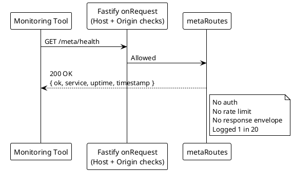

# Health Check Endpoint

> [!abstract] Overview
> Lightweight liveness probe to verify the backend process is running and responsive. Watchman has no authentication (see [[docs/adr/017-remove-authentication-frontend-v2-migration|ADR-017]]).
>
> Related: [[docs/api/services-health|Services Health]] covers per-service health snapshots with two-tier reachability model.

## Endpoint

| Property   | Value                                              |
| ---------- | -------------------------------------------------- |
| **Method** | `GET`                                              |
| **Path**   | `/meta/health`                                     |
| **Auth**   | None                                               |
| **Rate**   | No rate limit                                      |
| **Cache**  | None                                               |
| **Source** | `apps/backend/src/transport/http/routes/meta.ts`   |

The backend starts listening before services are brought up, so this endpoint answers even while a slow service is still connecting.

## Request

No parameters or body required.

## Response

### 200 OK

```json
{
  "ok": true,
  "service": "watchman-backend-v2",
  "uptime": 1234.56,
  "timestamp": "2026-10-20T12:00:00.000Z"
}
```

| Field       | Type      | Description                   |
| ----------- | --------- | ----------------------------- |
| `ok`        | `boolean` | Always `true` when responding |
| `service`   | `string`  | `"watchman-backend-v2"`       |
| `uptime`    | `number`  | Seconds since process start   |
| `timestamp` | `string`  | ISO 8601 timestamp            |

The response is not wrapped in a `{ data }` envelope.

> [!note] Log sampling
> The `logSamplingPlugin` logs only 1 in 20 `/meta/health` requests, so frequent probes do not flood the logs.

## Version Endpoint

`GET /meta/version` returns `{ "version": string, "node": string }`. `version` is `SERVER_VERSION` from `apps/backend/src/version.ts` (kept equal to the backend `package.json` version by a test), the same value the WebSocket `connection` frame reports.

## Usage

### curl

```bash
curl -f http://localhost:3001/meta/health
# or, in apps/backend/:
npm run health-check
```

### Frontend

```typescript
// apps/frontend/src/services/apiClient/endpoints.ts (exposed on apiClient;
// no dashboard component calls it at present)
const health = await apiClient.getHealth(); // GET /meta/health
```

### Desktop

The Electron main process polls `/meta/health` until the spawned backend is ready, then uses it as a post-startup watchdog (`apps/desktop/src/backend.ts`).

## Related

- [[docs/api/index|API Index]]
- [[docs/api/services-health|Services Health]]
- [[docs/architecture/backend-architecture|Backend Architecture]]

## PlantUML Diagrams

### Health Check Response


