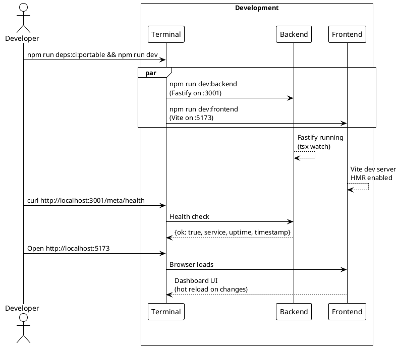
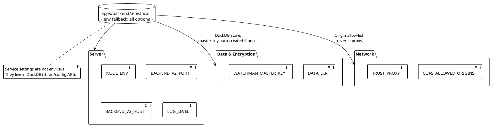
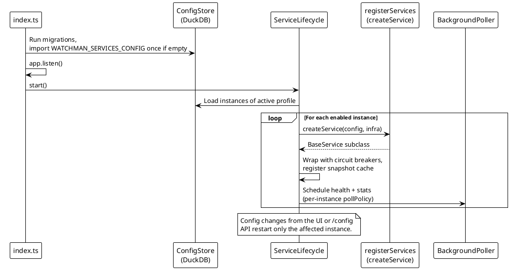

# Common Tasks

> [!abstract] Purpose
> Quick reference for frequently performed tasks in the Watchman project.

## Startup Flows

### Option A — macOS Desktop

```bash
./install.sh
npm run electron:prod
```

Installs to `/Applications/Watchman.app`. Backend auto-spawns on loopback port.

### Option B — Production Self-Host (Server)

```bash
npm run deps:ci:portable && npm run build && npm run start
```

Builds production artifacts and runs the backend (`:3001`) and `vite preview` (`:4173`) concurrently. For access from other machines, set `CORS_ALLOWED_ORIGINS=http://<server>:4173` in `apps/backend/.env.local`. For a long-running install behind a reverse proxy, see [[docs/guides/deployment|Deployment Guide]].

### Option C — Development

```bash
npm run deps:ci:portable && npm run dev
```

Starts Vite (5173) + Fastify (3001) with hot reload. See [[docs/guides/setup|Setup Guide]].

## Development Tasks

### Check Backend Health

```bash
curl http://localhost:3001/meta/health
```

### View API Documentation

There is no Swagger UI. Read `apps/backend/openapi.yaml` or [[docs/reference/openapi-spec|OpenAPI Spec]].

### Watch Backend Tests

```bash
npm run test:watch
```

### Run All Tests

```bash
npm run test:all       # Backend + frontend concurrently
npm run test:e2e       # Playwright smoke tests
npm run test:e2e:visual # Update E2E snapshots
```

### Generate TypeScript Types from OpenAPI

```bash
npm run generate:types
```

This syncs `apps/backend/openapi.yaml` → `apps/frontend/src/types/generated.ts`. Until the client migration is complete, also keep `apps/frontend/src/services/apiClient/types.ts` aligned by hand.

## Adding a Service

1. Add a `<Kind>InstanceSchema` to `apps/backend/src/config/services.ts` and include it in `ServiceInstanceSchema`
2. Add the kind to `ServiceKind` and `KIND_META` (form fields, `secretFields`) in `apps/backend/src/config/schemas/fieldMetadata.ts`
3. Implement a `BaseService` subclass under `apps/backend/src/domain/services/<kind>/`
4. Add a `case` to `buildService()` in `apps/backend/src/bootstrap/registerServices.ts`
5. Add a frontend renderer under `apps/frontend/src/services/renderers/` and register the kind in the renderer index, setup categories, service visuals, and bento layout
6. Update the OpenAPI spec only if a response shape changes
7. Create or update the integration doc

No new routes or environment variables are needed: `/services/:kind/*` and `/config/*` are generic. See [[docs/guides/adding-services|Adding Services Guide]] for details.

## Configuration

### Configure Services and Instances

Use the Setup Wizard (`/setup`) or **Settings → Services** (`/settings/services`). Each instance of a kind has its own `instanceId` and is stored in DuckDB with secrets encrypted. The same operations are available through the `/config/services` API. See [[docs/features/multi-instance|Multi-Instance Support]].

### Explore Architecture Interactively

```bash
Open http://localhost:5173 in browser, or view the flow visualizer:
[[docs/flow-visualizer.html|Interactive Flow Visualizer]]
```

Pick a flow (poll cycle, dashboard load, setup wizard, etc.) and trace data across packages with annotated payloads.

## Code Quality

### Lint Frontend & Backend

```bash
npm run lint            # Frontend ESLint
npm run lint:backend    # Backend ESLint
```

### Format Code

```bash
npm run format          # Uses Prettier
npm run format:check    # Check formatting without changes
```

## Troubleshooting

### Backend Won't Start

- Check port availability: `lsof -i :3001`
- Check the env file values are valid (see `apps/backend/.env.example`). Invalid values stop the backend with an `Invalid environment` error.
- Check `DATA_DIR` is writable
- Check Node.js version: `node --version` (need 22+)

### Frontend Won't Build

- Check Node.js version and npm cache: `npm cache clean --force && npm run deps:ci:portable`
- If Vite errors, delete `apps/frontend/dist/` and rebuild: `npm run build`

### Desktop App Won't Launch (Option A)

- Verify `.app` built: `ls -la /Applications/Watchman.app`
- Check quarantine attribute: `xattr /Applications/Watchman.app` (should be empty)
- Manually remove quarantine: `xattr -d com.apple.quarantine /Applications/Watchman.app`

### Service Shows Offline

- Check the instance is enabled in **Settings → Services**
- Check its connection settings and credentials there
- Check network connectivity to service host
- Check `GET /config/load-errors` for instances that failed to start
- Check backend logs (stdout of the backend process)

## Related

- [[docs/guides/setup|Setup Guide]]
- [[docs/troubleshooting.md|Troubleshooting]]
- [[docs/reference/environment-variables|Environment Variables]]

## PlantUML Diagrams

### Development Workflow (Option C)



### Environment Configuration



### Service Lifecycle


