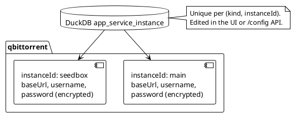
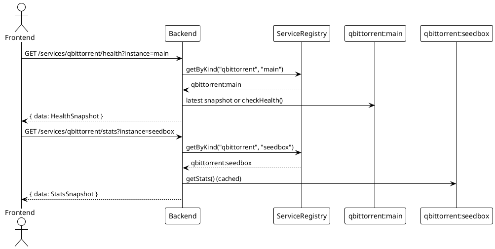
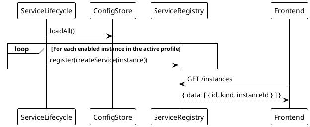

# Multi-Instance Support

> [!abstract] Overview
> Watchman can monitor several instances of the same service kind, for example two qBittorrent clients or two Synology NAS units. Each instance is a separate row in the DuckDB config store, identified by its `kind` and `instanceId`.

## Configuration

Instances are configured in the UI or through the config API, not with environment variables:

- **Setup Wizard** (`/setup`) or **Settings → Services** (`/settings/services`): add another instance of a kind and give it a distinct **Instance ID** (default `main`).
- **API**: `POST /config/services` with a body that includes `kind` and `instanceId`. See [[docs/api/config|Configuration API]].

The pair `(kind, instanceId)` is unique (`idx_service_kind_instance` in `apps/backend/src/config/store/migrations.ts`). Secret fields of every instance are encrypted with the master key. Each instance has its own `enabled` flag, `pollPolicy`, `cacheTtlMs`, and `timeoutMs`, and belongs to one profile (see [[docs/features/profiles|Profiles]]).

> [!info] Legacy numbered environment variables
> Older versions read numbered variables such as `QBITTORRENT_1_URL`. The current backend does not read them. The only legacy import is `WATCHMAN_SERVICES_CONFIG`, applied once when the store is empty. See [[docs/reference/environment-variables|Environment Variables]].

## Supported Services

Every service kind supports multiple instances. The kinds are listed in `SERVICE_KINDS` (`apps/backend/src/config/schemas/fieldMetadata.ts`): `adguard`, `albyHub`, `bitcoin`, `homebridge`, `ipfs`, `macMini`, `philipsBridge`, `qbittorrent`, `raspberryPi`, `roon`, `router`, `synology`, `tor`.

## API Pattern

The kind is a path parameter and the instance is an optional `instance` query parameter:

```
GET  /services/{kind}/health?instance={instanceId}
GET  /services/{kind}/stats?instance={instanceId}
POST /services/{kind}/control?instance={instanceId}
```

Examples:

- `/services/qbittorrent/health?instance=main`
- `/services/qbittorrent/stats?instance=seedbox`
- `/services/synology/health?instance=nas2`

If `instance` is omitted, the first registered instance of that kind is used. An unknown instance returns `404 NOT_FOUND`.

## Instance Discovery

`GET /instances` lists every running instance, and `GET /instances/{kind}` lists the instances of one kind:

```json
{
  "data": [
    { "id": "qbittorrent:main", "kind": "qbittorrent", "instanceId": "main" },
    { "id": "qbittorrent:seedbox", "kind": "qbittorrent", "instanceId": "seedbox" }
  ]
}
```

The `id` is `<kind>:<instanceId>`. Only enabled instances in the active profile are running and listed. `GET /config/services` lists all stored instances, including disabled ones.

## Implementation

- `ConfigStore` (`apps/backend/src/config/store/ConfigStore.ts`) stores and validates instances with the Zod `ServiceInstanceSchema`.
- `ServiceLifecycle` creates one `BaseService` per enabled instance through `createService()` in `apps/backend/src/bootstrap/registerServices.ts`.
- `ServiceRegistry` (`apps/backend/src/domain/ServiceRegistry.ts`) indexes services by id and by kind; `getByKind(kind, instanceId)` resolves API requests.

## PlantUML Diagrams

### Instance Configuration Pattern



### Multi-Instance API Routing



### Instance Discovery Flow



## Related

- [[docs/features/service-monitoring|Service Monitoring]]
- [[docs/features/ui-configuration|UI Configuration]]
- [[docs/api/config|Configuration API]]
- [[docs/reference/environment-variables|Environment Variables]]
