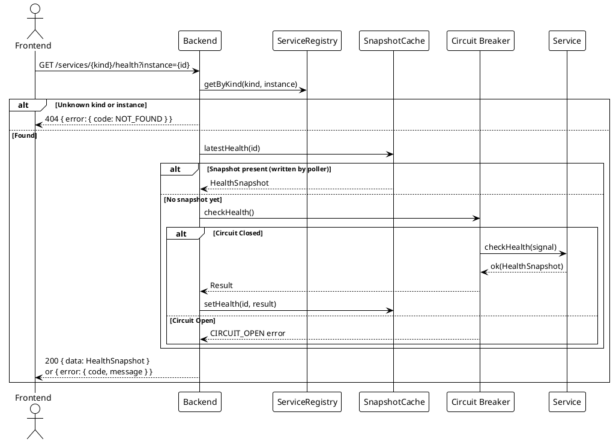
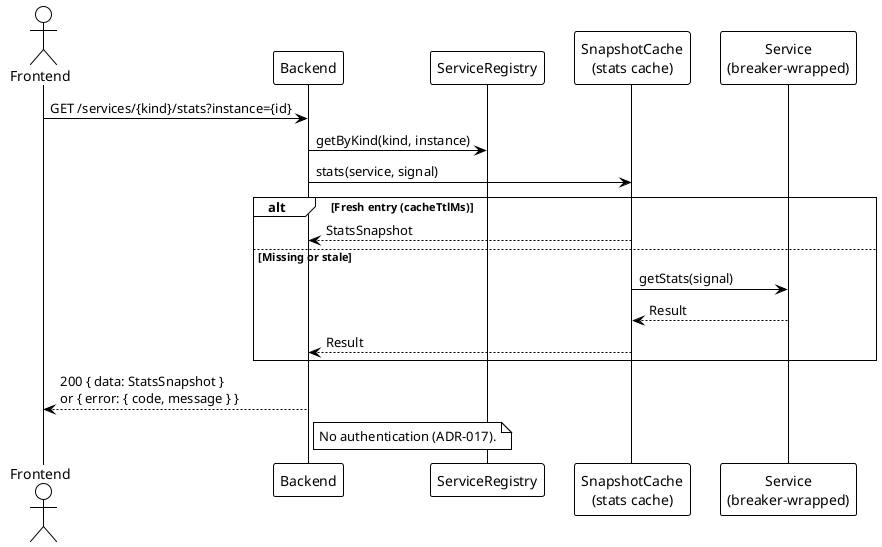
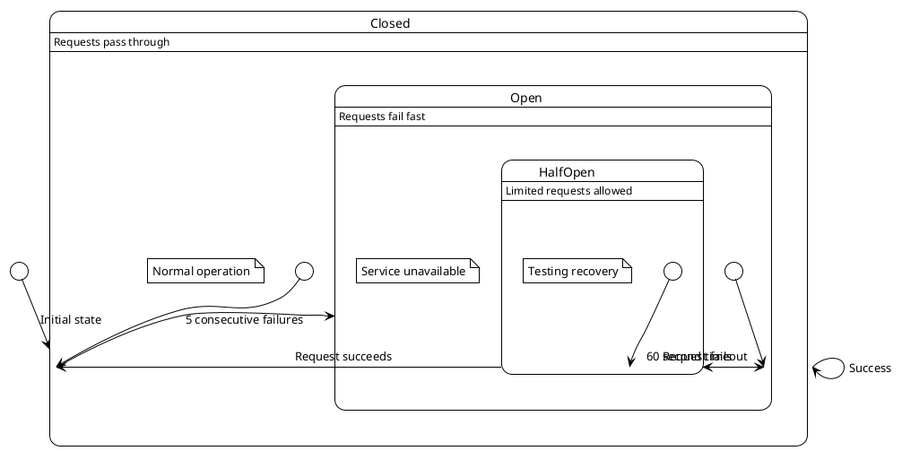

# Service Monitoring

> [!abstract] Overview
> Watchman's core feature is monitoring the health and statistics of self-hosted services through a unified interface.

## Architecture

### Service Pattern

Every service extends `BaseService` (TypeScript, v2) and implements two-tier health checks:

```typescript
export class ServiceName extends BaseService {
  readonly kind = "service-name";

  async checkHealth(signal: AbortSignal): Promise<HealthResult> {
    // Two-tier health: ICMP ping (host) + protocol probe (service)
    // Always returns ok(HealthSnapshot) — errors become reachable: false snapshots
    return withHostPing(
      { host: this.host, ... },
      async (sig) => { /* protocol probe */ },
      signal
    );
  }

  async getStats(signal: AbortSignal): Promise<StatsResult> {
    // Detailed metrics — also always returns ok(StatsSnapshot)
  }
}
```

**Health Model (Phase 0a+):** Each `HealthSnapshot` carries both tiers:
- `host: { reachable: boolean, pingMs?: number }` — ICMP reachability
- `service: { ok: boolean, latencyMs?: number, ... }` — protocol probe result
- `reachable: boolean` — composite (host AND service)

See [[docs/adr/019-two-tier-health-and-monitoring-upgrades|ADR-019]], [[apps/backend/src/domain/BaseService.ts]], and [[apps/backend/src/domain/ServiceRegistry.ts]].

### BackgroundPoller

The background poller (`createBackgroundPoller` in `apps/backend/src/infra/scheduler/poller.ts`) orchestrates all services:

1. Tracks services that `ServiceLifecycle` brings up
2. Polls each service on its `pollPolicy` (defaults: health 10 s, stats 30 s, 10% jitter)
3. Emits `service.health.updated` / `service.stats.updated` after each successful poll, or `service.error` on failure
4. Broadcaster publishes events (including snapshots) to WebSocket clients
5. Applies circuit breaker pattern for fault tolerance

Metrics are not persisted: the time-series writer was removed in [[docs/adr/019-revert-split-deploy-and-remove-time-series|ADR-019]]. Sparklines use an in-memory history in the browser (`apps/frontend/src/lib/metricHistory.ts`).

### Health Check Flow

```
Frontend → GET /services/{kind}/health?instance={id}
  → Fastify route handler
  → SnapshotCache latest health (written by the poller)
  → live checkHealth() through the circuit breaker only if no snapshot exists yet
  → Return JSON { data: HealthSnapshot }
```

### Stats Flow

```
Frontend → GET /services/{kind}/stats?instance={id}
  → Fastify route handler
  → SnapshotCache stats cache (TTL cacheTtlMs)
  → service.getStats() through the circuit breaker on a miss
  → Return JSON { data: StatsSnapshot }
```

## Supported Services

See [[docs/integrations/index|Service Integrations]] for per-service documentation.

## Caching

- **Health**: served from the latest snapshot written by the background poller (`SnapshotCache`)
- **Statistics**: per-instance stats cache with TTL `cacheTtlMs` (default 10 s)
- **Poll interval**: per-instance `pollPolicy` (defaults: health 10 s, stats 30 s, 10% jitter)

## Circuit Breaker

Each instance has separate breakers for health and stats (`apps/backend/src/index.ts`, `infra/circuitBreaker/`):

- **Failure threshold**: 5 consecutive failures
- **Reset timeout**: 60 seconds, then one half-open trial call
- **Request timeout**: per-instance `timeoutMs` (default 5 seconds). One poll of a service may take up to `max(10 s, 2 × timeoutMs)`, since a probe can chain two bounded requests

## Frontend Coverage Notes (Monitoring UI)

### Two-Tier Status Rendering (Phase 0a — F1 + F2 + F3)

Two-tier status dots are rendered in two places with full color-blind accessibility:

#### F1: ServiceTile (Dashboard Grid)

[[docs/components/service-tile|ServiceTile]] renders **two-tier status dots** when backend supplies both `host` and `service` health tiers:

- First dot: **host tier** (ICMP reachability) — "host: up/down"
- Second dot: **service tier** (protocol probe) — "service: up/down"
- Fallback: single dot when only one or neither tier is present (backward compat)

Implementation: `[[apps/frontend/src/components/tile/ServiceTile.tsx]]` (lines 59–65, 140–155)
Tests: `[[apps/frontend/src/components/tile/ServiceTile.test.tsx]]` (6 tests)

#### F2: ServiceDetailSheet (Detail View)

[[docs/components/service-detail-sheet|ServiceDetailSheet]] header now also renders **two-tier status dots** using identical pattern:

- First dot: **host tier** (ICMP reachability) — "host: up/down"
- Second dot: **service tier** (protocol probe) — "service: up/down"
- Fallback: single dot when only one or neither tier is present (backward compat)

Implementation: `[[apps/frontend/src/components/detail/ServiceDetailSheet.tsx]]` (lines 80–90, 171–186)
Tests: `[[apps/frontend/src/components/detail/ServiceDetailSheet.test.tsx]]` (5 tests)

#### F3: Color-Blind Accessibility (Phase 0a)

**STATUS: COMPLETE** — StatusDot now includes shape-based tone discrimination for color-blind users:

- **ok** (green): Circle ⚪
- **warn** (yellow): Diamond ◇
- **crit** (red): Square ▢
- **neutral** (gray): Rectangle ▬

All dots expose a `data-state` attribute matching their tone, allowing semantic testing and CSS targeting without relying on color.

Implementation: [[docs/components/primitives/status-dot|StatusDot]] primitive
Tests: [[apps/frontend/src/components/primitives/StatusDot.test.tsx]] (5 tests covering data-state attribute)

#### User Experience

This allows users to distinguish at both dashboard and detail view levels:
- Host ✅ + Service ✅ = normal operation (both green circles)
- Host ✅ + Service ❌ = daemon issue (green circle + red square)
- Host ❌ + Service ❌ = network issue (both red squares)
- Shape is visible to all users, color is redundant reinforcement

### Other Monitoring UI Tests

- Dashboard coverage: `apps/frontend/src/components/dashboard/BentoDashboard.smoke.test.tsx` and `dashboardData.test.ts`
- Detail view coverage: `apps/frontend/src/components/detail/detail.smoke.test.tsx`
- Hook coverage: `useServiceHealth.test.ts`, `useAggregatedHealth.test.ts`, and `useServiceInstances.test.ts` under `apps/frontend/src/hooks/`

> [!note] Removed tests
> The former `useDashboardQueries`, `UpdateBadge`, `ServiceLink`, and `ServerStatusBadge` components and their tests no longer exist in `apps/frontend/src/components/`.

## PlantUML Diagrams

### Health Check Flow



### Stats Flow



### Circuit Breaker State Machine



## Related

- [[docs/features/multi-instance|Multi-Instance Support]]
- [[docs/features/real-time-updates|Real-Time Updates]]
- [[docs/integrations/index|Service Integrations]]
- [[docs/performance/caching-strategies|Caching Strategies]]
