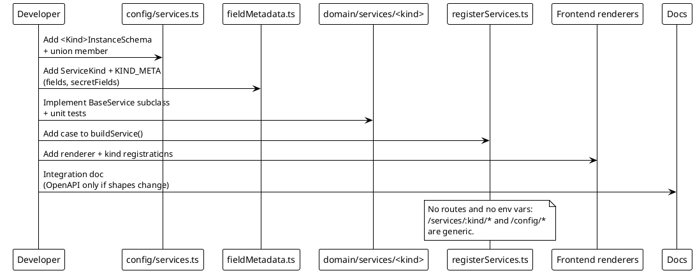
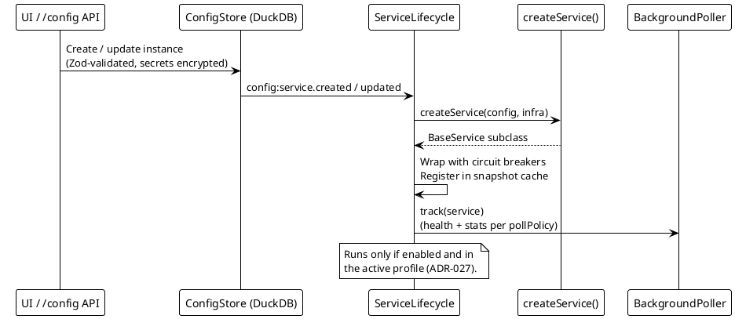
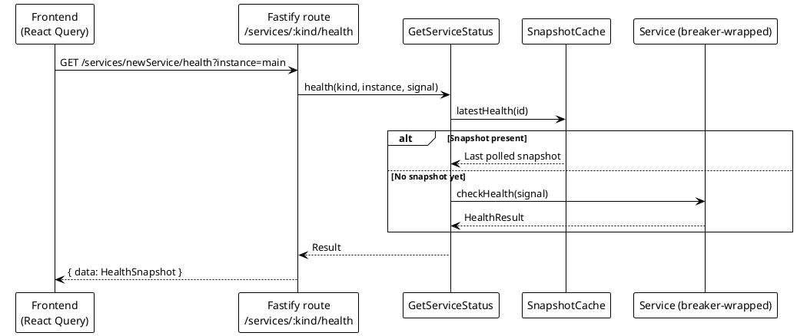

# Adding Services Guide

> [!abstract] Overview
> This guide walks you through adding a new monitored-service kind to Watchman. It matches the `add-service` agent skill (`.agents/skills/add-service/SKILL.md`). Read the relevant [[docs/integrations/index|integration page]] first when you change an existing kind.

## Overview

A service kind touches these places:

1. **Config schema**: a Zod instance schema in `apps/backend/src/config/services.ts`
2. **Kind metadata**: form fields and secret fields in `apps/backend/src/config/schemas/fieldMetadata.ts`
3. **Service class**: a `BaseService` subclass under `apps/backend/src/domain/services/<kind>/`
4. **Factory**: a `case` in `buildService()` in `apps/backend/src/bootstrap/registerServices.ts`
5. **Frontend renderer**: a tile/detail renderer under `apps/frontend/src/services/renderers/`
6. **Tests and documentation**

You do **not** add routes or environment variables. The HTTP routes are generic per kind (`GET /services/:kind/health`, `GET /services/:kind/stats`, with `?instance=<instanceId>`). Connection settings live in the DuckDB config store and are edited in the UI or through `/config/services`.

## Step 1: Add the Instance Schema

In `apps/backend/src/config/services.ts`, extend `BaseInstanceSchema` (which provides `instanceId`, `enabled`, `pollPolicy`, `cacheTtlMs`, and `timeoutMs`):

```typescript
export const NewServiceInstanceSchema = BaseInstanceSchema.extend({
  kind: z.literal("newService"),
  baseUrl: z.string().url(),
  apiKey: z.string().default(""),
});
```

Add it to the `ServiceInstanceSchema` discriminated union and export `type NewServiceInstance = z.infer<typeof NewServiceInstanceSchema>`. This schema validates every config write from the UI and the `/config` API.

## Step 2: Add Kind Metadata

In `apps/backend/src/config/schemas/fieldMetadata.ts`, add the kind to the `ServiceKind` union and to `KIND_META`:

```typescript
newService: {
  kind: "newService",
  label: "New Service",
  description: "New Service via HTTP API.",
  schema: NewServiceInstanceSchema,
  fields: withCommon([
    { name: "baseUrl", label: "Base URL", type: "url", required: true },
    { name: "apiKey", label: "API key", type: "password", secret: true },
  ]),
  secretFields: ["apiKey"],
},
```

`GET /config/kinds` serves this metadata, and the Setup Wizard and Services page build their forms from it. `ConfigStore` encrypts the fields listed in `secretFields` with the master key and redacts them in API responses. List every credential there.

## Step 3: Implement the Service Class

Create `apps/backend/src/domain/services/newService/NewServiceService.ts`:

```typescript
import { BaseService, type HealthResult, type PollPolicy, type StatsResult } from "../../BaseService.js";
import { withHostPing } from "../../health.js";
import { ok, err } from "../../../core/result.js";
import type { HttpClient } from "../../../infra/http/client.js";
import type { PingProber } from "../../../infra/net/pingProbe.js";
import type { NewServiceInstance } from "../../../config/services.js";

export interface NewServiceDeps {
  http: HttpClient;
  ping: PingProber;
  config: NewServiceInstance;
  now: () => number;
}

export class NewServiceService extends BaseService {
  readonly kind = "newService";
  readonly instanceId: string;
  readonly pollPolicy: PollPolicy;

  constructor(private readonly deps: NewServiceDeps) {
    super();
    this.instanceId = deps.config.instanceId;
    this.pollPolicy = deps.config.pollPolicy;
  }

  async checkHealth(signal: AbortSignal): Promise<HealthResult> {
    // Ping and protocol probe run in parallel; always resolves ok(snapshot).
    return withHostPing(
      { host: new URL(this.deps.config.baseUrl).hostname, timeoutMs: this.deps.config.timeoutMs,
        pingCount: 1, prober: this.deps.ping },
      async (s) => { /* call the service API with signal s */ return { reachable: true }; },
      this.deps.now(),
      signal,
    );
  }

  async getStats(signal: AbortSignal): Promise<StatsResult> {
    // Return ok({ metrics, at }) or err(DomainError) from core/errors.ts
    return ok({ metrics: {}, at: this.deps.now() });
  }
}
```

Guidelines:

- Use the shared infrastructure in `apps/backend/src/infra/` (HTTP client, ping/TCP probes, SSH, SNMP, cache helpers). Pass `signal` to all network I/O so request timeouts cancel work.
- Return `Result` values; do not throw for expected failures. Use the `DomainError` subclasses in `core/errors.ts`.
- Use `core/ttlMemo.ts` for slow-changing data that should not be fetched every poll.
- Optional hooks: `onStart()` / `onStop()` for long-lived connections. Services are read-only: never add a method that changes the monitored service ([[docs/adr/032-monitoring-only-no-service-control|ADR-032]]).
- Never log credentials. Pino redacts common field names, but do not rely on that alone.

Circuit breakers, the snapshot cache, and polling are added by `ServiceLifecycle` and the `index.ts` instrumentation. The service class does not set them up.

## Step 4: Register in the Factory

In `apps/backend/src/bootstrap/registerServices.ts`, import the class and add a `case` to `buildService()`:

```typescript
case "newService":
  return new NewServiceService({ http, ping, config: instance, now });
```

If the service needs a new infrastructure dependency, add it to `ServiceInfra` and create it in `apps/backend/src/index.ts`. `ServiceLifecycle` calls `createService()` for each enabled instance in the active profile and restarts only the affected instance when its config changes.

## Step 5: Add the Frontend Renderer

The dashboard renders every kind through a renderer, not a per-service card component:

- Create `apps/frontend/src/services/renderers/newService.ts` exporting a `ServiceRenderer` (summary metrics, detail sections, optional quick link). Use an existing renderer such as `ipfs.ts` as a model.
- Add the kind to the `ServiceKind` union in `renderers/types.ts` and to `RENDERERS` in `renderers/index.ts`.
- Add the kind to `apps/frontend/src/pages/setup/kindCategories.ts` (wizard category), `apps/frontend/src/lib/serviceVisuals.ts` (icon), and `apps/frontend/src/config/bentoLayout.ts` (tile size).
- Fetch data through React Query and the existing API client.

## Step 6: OpenAPI and Types

Update `apps/backend/openapi.yaml` only when an HTTP response shape changes. Then run `npm run generate:types` and keep `apps/frontend/src/services/apiClient/types.ts` aligned by hand. A new kind alone does not change the generic route shapes.

## Step 7: Tests and Documentation

- Add `NewServiceService.test.ts` next to the class. Use a fake `PingProber` (see the local `fakePing()` helpers in existing service tests) and fake infra clients.
- Verify health, timeout, retry, circuit-breaker behavior, secret handling (encryption and redaction), and multiple instances of the kind.
- Create `docs/integrations/newservice.md` following the [[docs/integrations/index|integration template]], and update the other affected pages with the `update-watchman-docs` skill.

## Checklist

- [ ] Instance schema added to `config/services.ts` and the `ServiceInstanceSchema` union
- [ ] Kind added to `ServiceKind` and `KIND_META` in `config/schemas/fieldMetadata.ts`, with all credentials in `secretFields`
- [ ] `BaseService` subclass with `checkHealth()` and `getStats()` under `domain/services/<kind>/`
- [ ] `case` added to `buildService()` in `bootstrap/registerServices.ts` (and `ServiceInfra` if needed)
- [ ] Frontend renderer created and registered (`renderers/index.ts`, `renderers/types.ts`)
- [ ] Kind added to `kindCategories.ts`, `serviceVisuals.ts`, and `bentoLayout.ts`
- [ ] OpenAPI and generated types updated, if a response shape changed
- [ ] Unit tests cover health, stats, timeouts, and multiple instances
- [ ] Integration documentation created and related docs updated

## PlantUML Diagrams

### Service Integration Flow



### Service Instance Lifecycle



### API Request Path



## Related

- [[docs/integrations/index|Service Integrations]]
- [[docs/architecture/backend-architecture|Backend Architecture]]
- [[docs/components/index|Components Index]]
- [[docs/features/multi-instance|Multi-Instance Support]]
