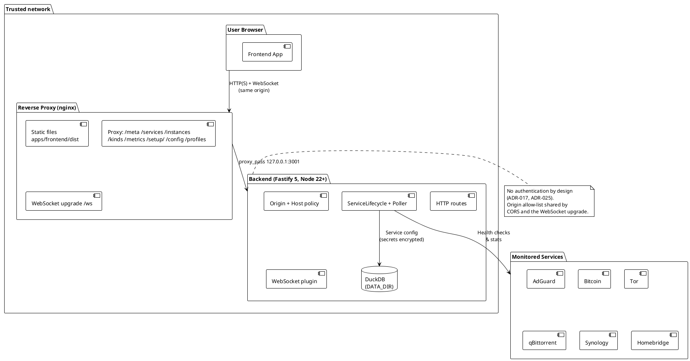
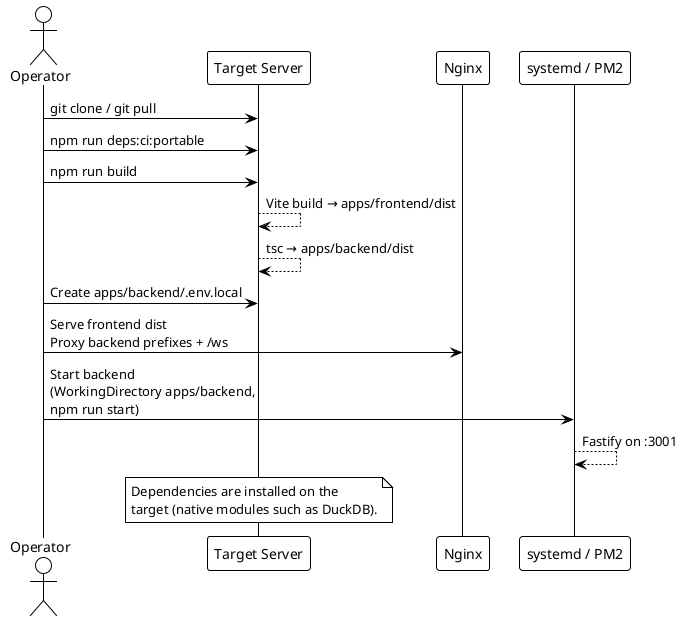
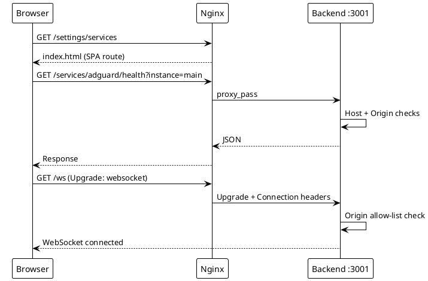

# Deployment Guide — Production Server (Option B)

> [!abstract] Overview
> This guide covers running Watchman on a server (Raspberry Pi, home server, VM) without Docker.
>
> **Looking for other startup modes?** See [[docs/getting-started|Getting Started]] for:
> - Option A: macOS Desktop
> - Option B: Production Server (this guide)
> - Option C: Development

> [!warning] Trusted network only
> Watchman is a single-user application for a trusted network. It has **no authentication, no CSRF protection, and no rate limiting** by design (see [[docs/adr/017-remove-authentication-frontend-v2-migration|ADR-017]] and [[docs/adr/025-trusted-network-security-model-and-audit-remediation|ADR-025]]). Do not expose the backend or the reverse proxy to the internet. Use a firewall, a VPN, or a closed LAN.

## Prerequisites

- Node.js 22 or newer and npm 10 or newer on the target machine (`engines` in the root `package.json`; CI uses Node 24)
- Git, to clone the repository
- Optional: a reverse proxy such as nginx or Caddy. It lets you serve the built frontend and the backend from one origin, and add TLS (Transport Layer Security). TLS is optional on a trusted LAN.
- Optional: systemd or PM2 to keep the backend running

Install dependencies on the target machine itself. The backend uses native modules (for example the DuckDB driver), so do not copy `node_modules` from a different platform.

## Quick Start (test run)

```bash
npm run deps:ci:portable && npm run build && npm run start
```

This:

1. Installs the root, frontend, and backend workspace dependencies from the lockfile
2. Builds the production frontend (`apps/frontend/dist/`) and compiles the backend with `tsc` (`apps/backend/dist/`)
3. Starts the backend (`node dist/index.js` on port 3001) and `vite preview` (port 4173) together

`vite preview` proxies the backend route prefixes and `/ws` to port 3001, so the dashboard works at `http://localhost:4173` on the server. To open it from another machine, add `CORS_ALLOWED_ORIGINS=http://<server>:4173` to the backend env file. Otherwise the backend rejects the WebSocket upgrade and configuration writes from that origin, because the proxy rewrites the `Host` header and the request no longer looks same-origin. Use this for a test run. For a long-running install, serve `apps/frontend/dist/` from a reverse proxy and run only the backend under systemd or PM2, as described below.

## Build Details

```bash
npm run build            # Production frontend + backend (tsc)
npm run build:frontend   # Frontend only
npm run build:backend    # Backend only (tsc → apps/backend/dist/)
npm run build:dev        # Dev-mode frontend (fast, unminified)
```

The backend entry point is `apps/backend/src/index.ts`, compiled to `apps/backend/dist/index.js`. Start it with `npm run start:backend` from the repository root, or `npm run start` inside `apps/backend/`.

## Environment Configuration

The backend loads environment variables with `dotenv` from its **working directory**: first `.env.local`, then `.env` as a fallback for anything still unset (`apps/backend/src/loadDotenv.ts`). The npm workspace scripts run in `apps/backend/`, so the file is `apps/backend/.env.local` (gitignored). Variables already set in the process environment (for example by systemd) take precedence over both files. See [[docs/reference/environment-variables|Environment Variables]] for the full reference.

```bash
cp apps/backend/.env.example apps/backend/.env.local
```

Example for a server behind nginx on the same host:

```bash
NODE_ENV=production
BACKEND_V2_PORT=3001
BACKEND_V2_HOST=127.0.0.1          # 0.0.0.0 only if clients connect to the backend directly
LOG_LEVEL=info
DATA_DIR=/var/lib/watchman         # DuckDB config store, master.key, master.key.salt
WATCHMAN_MASTER_KEY=<output of: openssl rand -base64 32>
CORS_ALLOWED_ORIGINS=https://watchman.your-domain.example
TRUST_PROXY=true                   # only because nginx is the sole client of the backend
```

| Variable               | Default       | Notes                                                                                                                                                                                                                                                                                                       |
| ---------------------- | ------------- | ----------------------------------------------------------------------------------------------------------------------------------------------------------------------------------------------------------------------------------------------------------------------------------------------------------- |
| `NODE_ENV`             | `development` | `production` gives JSON log lines; `development` uses `pino-pretty`.                                                                                                                                                                                                                                        |
| `BACKEND_V2_PORT`      | `3001`        | HTTP and WebSocket port.                                                                                                                                                                                                                                                                                    |
| `BACKEND_V2_HOST`      | `0.0.0.0`     | Bind address. Use `127.0.0.1` when a local reverse proxy is the only client.                                                                                                                                                                                                                                |
| `LOG_LEVEL`            | `info`        | Pino level: `fatal`, `error`, `warn`, `info`, `debug`, `trace`.                                                                                                                                                                                                                                             |
| `DATA_DIR`             | `./data`      | Resolved against the working directory. Use an absolute path for a service install.                                                                                                                                                                                                                         |
| `WATCHMAN_MASTER_KEY`  | _(unset)_     | Encrypts service secrets at rest (AES-256-GCM). If unset, the backend creates `{DATA_DIR}/master.key` on first start. A passphrase (not a 32-byte base64 or hex key) also creates `{DATA_DIR}/master.key.salt`.                                                                                             |
| `CORS_ALLOWED_ORIGINS` | _(unset)_     | Comma-separated extra browser origins. `watchman://`, `http://localhost:*`, and `http://127.0.0.1:*` are always allowed. The host names in this list are also accepted by the Host-header check.                                                                                                             |
| `TRUST_PROXY`          | `false`       | `true` or `1` makes Fastify read the client address from `X-Forwarded-*` headers. Enable it only when a trusted reverse proxy is the only path to the backend.                                                                                                                                               |

> [!important] Served origin and Host header
> The backend rejects requests whose `Host` header is not recognised, to block DNS rebinding. It accepts loopback names, IP literals, this machine's hostname (and `<hostname>.local`), and the host names in `CORS_ALLOWED_ORIGINS`. If users open Watchman through another DNS name (for example `watchman.your-domain.example`), add that origin to `CORS_ALLOWED_ORIGINS`.

> [!info] Service connections are not environment variables
> Service connection settings (URLs, credentials, instances) live in the DuckDB config store. Manage them in the UI (Setup Wizard, **Settings → Services**) or through the `/config` API. A legacy `WATCHMAN_SERVICES_CONFIG` value is imported once when the store is empty and ignored after that.

## Reverse Proxy (nginx)

In a browser, the frontend calls the backend with **relative URLs** and opens the WebSocket on the page's own host. The built frontend and the backend must therefore share one origin. The backend does not serve the frontend files, so the proxy serves `apps/frontend/dist/` and forwards the backend's root-level route prefixes. There is no `/api/` prefix.

```nginx
server {
    listen 443 ssl;                 # or: listen 80; on a trusted LAN without TLS
    server_name watchman.your-domain.example;

    ssl_certificate     /path/to/cert.pem;
    ssl_certificate_key /path/to/key.pem;

    root /opt/watchman/apps/frontend/dist;

    # Single-page app. /setup and /settings/* are client-side routes.
    location / {
        try_files $uri /index.html;
    }

    # Backend HTTP routes (mounted at the root, see apps/backend/src/transport/http/routes/)
    location ~ ^/(meta|services|instances|kinds|metrics|config|profiles)(/|$) {
        proxy_pass http://127.0.0.1:3001;
        proxy_set_header Host $host;
        proxy_set_header X-Forwarded-For $proxy_add_x_forwarded_for;
        proxy_set_header X-Forwarded-Proto $scheme;
    }

    # Backend setup routes (/setup/status, /setup/philips-bridge/pair).
    # The trailing slash keeps the /setup wizard page on the frontend.
    location /setup/ {
        proxy_pass http://127.0.0.1:3001;
        proxy_set_header Host $host;
        proxy_set_header X-Forwarded-For $proxy_add_x_forwarded_for;
        proxy_set_header X-Forwarded-Proto $scheme;
    }

    # WebSocket
    location = /ws {
        proxy_pass http://127.0.0.1:3001;
        proxy_http_version 1.1;
        proxy_set_header Upgrade $http_upgrade;
        proxy_set_header Connection "upgrade";
        proxy_set_header Host $host;
        proxy_set_header X-Forwarded-For $proxy_add_x_forwarded_for;
    }
}
```

> [!note] Keep the prefix list in sync
> The prefix list mirrors `BACKEND_PREFIXES` in `apps/frontend/vite.config.ts`. If a new top-level backend route is added, update both.

> [!tip] WebSocket connection limit
> The backend allows 10 WebSocket connections per client address. Behind a proxy without `TRUST_PROXY=true`, every browser appears to come from the proxy address and shares that limit.

## Process Management

Run the backend from `apps/backend/` so that `dotenv` finds `.env.local` (or `.env`) there and a relative `DATA_DIR` resolves to `apps/backend/data`. The backend shuts down cleanly on `SIGTERM`, `SIGINT`, and `SIGHUP`: it stops the HTTP/WebSocket server first, then the services, and closes DuckDB last. If that takes longer than 10 seconds it exits with code 1.

### systemd

```ini
[Unit]
Description=Watchman Backend
After=network-online.target
Wants=network-online.target

[Service]
Type=simple
User=watchman
WorkingDirectory=/opt/watchman/apps/backend
ExecStart=/usr/bin/npm run start
Restart=on-failure
Environment=NODE_ENV=production

[Install]
WantedBy=multi-user.target
```

`npm run start` runs `node dist/index.js`. You can use `ExecStart=/usr/bin/node dist/index.js` instead; `/meta/version` then reports `dev`, because it reads the version from the npm script environment. Adjust the `npm` and `node` paths to the output of `command -v npm` and `command -v node`.

### PM2

```bash
pm2 start npm --name watchman-backend --cwd /opt/watchman/apps/backend -- run start
pm2 save
pm2 startup
```

## Security Checklist

- [ ] The server and proxy are reachable only from the trusted network (firewall, VPN, or closed LAN). No port forwarding from the internet.
- [ ] `BACKEND_V2_HOST=127.0.0.1` when a local reverse proxy is the only client.
- [ ] `WATCHMAN_MASTER_KEY` is set, or the auto-created `{DATA_DIR}/master.key` exists. Back up the key together with `DATA_DIR`. If the key is lost, stored service secrets cannot be decrypted.
- [ ] `DATA_DIR` is backed up as a whole: `watchman.duckdb`, `master.key`, and `master.key.salt` when present.
- [ ] `CORS_ALLOWED_ORIGINS` lists the origin users open in the browser (for example `https://watchman.your-domain.example`). Nothing else.
- [ ] `TRUST_PROXY=true` only behind your own reverse proxy. Leave it `false` when clients connect directly.
- [ ] The env file stays out of version control (`.env` and `.env.local` are gitignored). Do not put secrets in tracked files.
- [ ] `NODE_ENV=production` is set.
- [ ] TLS on the proxy if your network threat model needs it.

## Monitoring

- **Health:** `curl -f http://127.0.0.1:3001/meta/health` (also `npm run health-check` in `apps/backend/`). See [[docs/api/health-check|Health Check]].
- **Version:** `GET /meta/version`.
- **Backend metrics:** `GET /metrics` returns a JSON snapshot (circuit breakers, poller, cache, service errors).
- **Logs:** Pino writes to stdout. Read them with `journalctl -u <unit>` or `pm2 logs watchman-backend`. Only 1 in 20 `/meta/health` requests is logged. Credentials and tokens are redacted.

## Updating

```bash
cd /opt/watchman
git pull
npm run deps:ci:portable
npm run build
sudo systemctl restart watchman   # or: pm2 restart watchman-backend
```

## PlantUML Diagrams

### Production Architecture



### Build and Deploy Pipeline



### Nginx Proxy Flow



## Related

- [[docs/guides/setup|Setup Guide]]
- [[docs/security/index|Security]]
- [[docs/reference/environment-variables|Environment Variables]]
- [[docs/guides/deploying-to-raspberry-pi|Pi Deploy Guide]]
