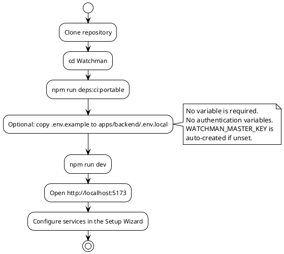
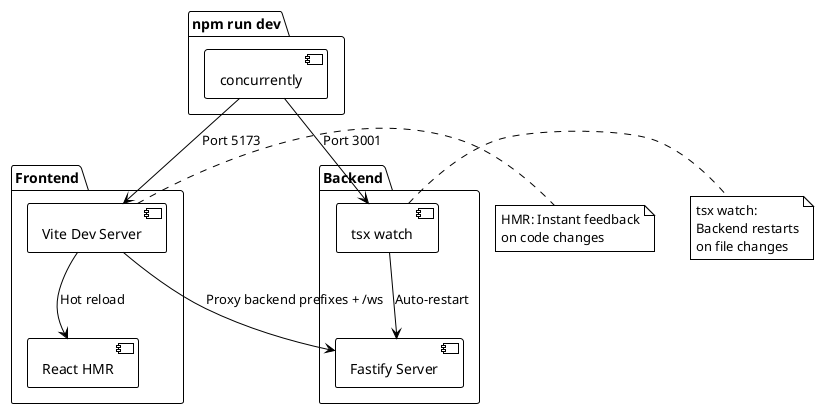

# Setup Guide — Development Mode (Option C)

> [!abstract] Overview
> This guide walks you through setting up Watchman for local development with hot reload.
>
> **Looking for other startup modes?** See [[docs/getting-started|Getting Started]] for:
> - Option A: macOS Desktop
> - Option B: Production Server
> - Option C: Development (this guide)

> [!tip] Agent sandbox
> Use Claude or Codex with its built-in sandbox and the current host access policy. See [[docs/guides/ai-agent-workflow|AI Agent Workflow]].

## Prerequisites

- **Node.js 22+** - Runtime environment (CI uses Node 24)
- **npm 10+** - Package manager
- **Git** - Version control

## Installation

### 1. Clone the Repository

```bash
git clone <YOUR_REPO_URL>
cd Watchman
```

### 2. Install Dependencies

```bash
npm run deps:ci:portable
```

This verifies the sole reviewed Git dependency, then installs the exact lockfile for the root,
frontend, and backend workspaces. Use `npm run deps:ci` when desktop packaging is also needed.

### 3. Configure Environment (optional)

The backend loads `.env.local` from its working directory with `dotenv`, and falls back to `.env`
for anything still unset. Real environment variables override both. Under `npm run dev` the
working directory is `apps/backend/`. Every variable has a default, so this step is optional for
local development:

```bash
cp apps/backend/.env.example apps/backend/.env.local
```

Useful values:

```bash
NODE_ENV=development
LOG_LEVEL=debug
# Optional. If unset, the backend creates {DATA_DIR}/master.key on first start.
WATCHMAN_MASTER_KEY=
```

There are no authentication variables. Watchman is single-user and has no login (see
[[docs/adr/017-remove-authentication-frontend-v2-migration|ADR-017]]).

> [!info] Service configuration
> Do not put service URLs or credentials in the env file. Configure services in the UI: the Setup Wizard at `/setup` or **Settings → Services** at `/settings/services`. They are stored in DuckDB under `DATA_DIR` (default `apps/backend/data/`), with secrets encrypted. See [[docs/reference/environment-variables|Environment Variables]].

### 4. Start Development Server

```bash
npm run dev
```

This starts both frontend and backend concurrently with hot reload:

- **Frontend (Vite)**: `http://localhost:5173` — Hot Module Reload (HMR) enabled. Vite proxies the backend route prefixes and `/ws` to port 3001.
- **Backend (Fastify)**: `http://localhost:3001` — Restarts on file changes via `tsx watch`

There is no Swagger UI. The API contract is `apps/backend/openapi.yaml`; see [[docs/reference/openapi-spec|OpenAPI Spec]].

### 5. Verify Setup

- Open `http://localhost:5173` in your browser. With no services configured, the dashboard redirects to the Setup Wizard.
- Check `http://localhost:3001/meta/health` for backend status

## Development Workflow

### Running Individual Services

```bash
# Frontend only
npm run dev:frontend

# Backend only
npm run dev:backend
```

### Code Quality

```bash
# Lint
npm run lint

# Fix lint issues
npm run lint:fix

# Format code
npm run format

# Check formatting
npm run format:check
```

### Testing

```bash
# Backend unit/integration tests
npm run test

# Frontend component tests
npm run test:frontend

# Run all (backend + frontend concurrently)
npm run test:all

# Watch mode (backend tests + auto-rerun on changes)
npm run test:watch

# E2E tests (Playwright smoke tests)
npm run test:e2e
```

## Project Structure

```
Watchman/
├── apps/
│   ├── frontend/           # React + TypeScript + Vite
│   ├── backend/            # Node.js + TypeScript + Fastify 5
│   └── desktop/            # Electron shell
├── docs/                   # Documentation (Obsidian knowledge base)
├── scripts/                # Repository scripts (Git hooks, dependency checks)
├── tools/                  # Dev scripts
└── package.json            # Root workspace config
```

## Related

- [[docs/guides/deployment|Deployment Guide]]
- [[docs/reference/environment-variables|Environment Variables]]
- [[docs/guides/contributing|Contributing Guide]]

## PlantUML Diagrams

### Setup Process



### Development Server Architecture


