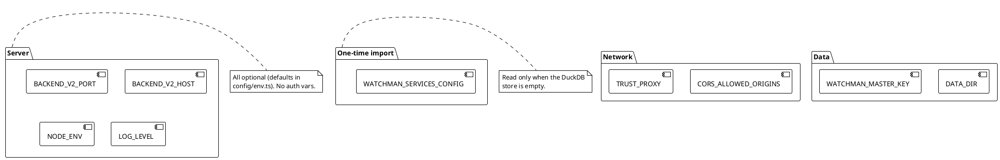
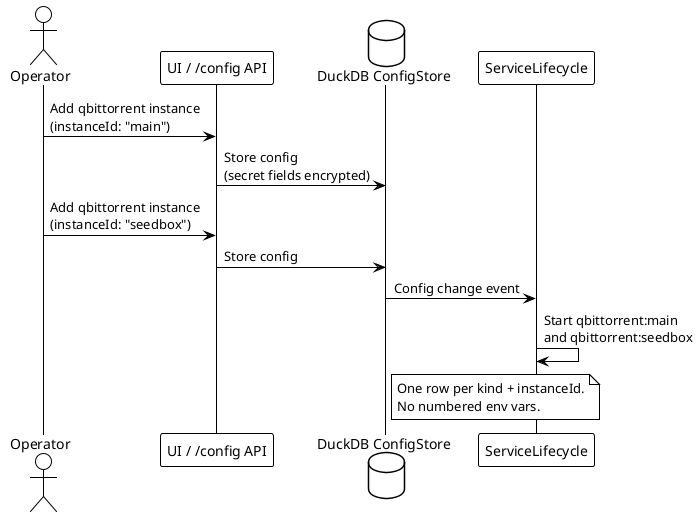

# Environment Variables

> [!abstract] Overview
> All backend process settings for Watchman. The schema is the Zod `EnvSchema` in `apps/backend/src/config/env.ts`; an invalid value stops the backend with an `Invalid environment` error.
>
> The backend loads them with `dotenv` from its **working directory**: `.env.local` first, then `.env` as a fallback for anything still unset (`apps/backend/src/loadDotenv.ts`). Under the npm workspace scripts that is `apps/backend/.env.local`. Variables already set in the process environment take precedence over both files. Start from `apps/backend/.env.example`. Both files are gitignored; keep them out of version control.

## No Required Variables

Every variable has a default or is optional. There is no authentication configuration.

> [!info] Authentication Removed
> As of v2.3, Watchman is a single-user home-lab application with **no authentication**. The former variables `AUTH_USERNAME`, `AUTH_PASSWORD_HASH`, and `JWT_SECRET` were removed. `FRONTEND_URL` is also no longer read; use `CORS_ALLOWED_ORIGINS`. See [[docs/adr/017-remove-authentication-frontend-v2-migration|ADR-017]] for context.
>
> **Network isolation** (firewall, VPN, or closed LAN) is the operator's responsibility.

## Master Key Configuration

| Variable              | Description                                                                                                                                         | Default                                                | Example                                     |
| --------------------- | --------------------------------------------------------------------------------------------------------------------------------------------------- | ------------------------------------------------------ | ------------------------------------------- |
| `WATCHMAN_MASTER_KEY` | AES-256-GCM key for encrypting service secrets at rest. A 32-byte base64 or hex key is used directly; any other string is a passphrase (salted scrypt). | Auto-provisioned at `{DATA_DIR}/master.key` if not set | Output of `openssl rand -base64 32`         |

> [!warning] Master Key Loss
> If the master key is lost or changed, all encrypted service secrets become unrecoverable. Back up `WATCHMAN_MASTER_KEY` (or `{DATA_DIR}/master.key`) together with `DATA_DIR`. A passphrase key also creates `{DATA_DIR}/master.key.salt`, which must be preserved too. If that salt file exists but is empty or corrupt, the backend refuses to start instead of replacing it; restore it from backup. Losing either requires re-entering all service credentials.

## Server Configuration

| Variable               | Description                                                                                                                                                           | Default       | Example                                      |
| ---------------------- | --------------------------------------------------------------------------------------------------------------------------------------------------------------------- | ------------- | -------------------------------------------- |
| `BACKEND_V2_PORT`      | Backend HTTP and WebSocket port, 1-65535 (changed from 3101 → 3001 in v2.3)                                                                                           | `3001`        | `3001`, `8080`                               |
| `BACKEND_V2_HOST`      | Backend server bind address                                                                                                                                           | `0.0.0.0`     | `127.0.0.1`, `0.0.0.0`                       |
| `NODE_ENV`             | `development`, `test`, or `production`. `development` pretty-prints logs with `pino-pretty`; other values write JSON lines to stdout.                                 | `development` | `production`                                 |
| `TRUST_PROXY`          | Fastify `trustProxy` setting (`true`/`1` enables it; anything else disables it). Set to `true` only when running behind a trusted reverse proxy. See note below.       | `false`       | `false`, `true`                              |
| `LOG_LEVEL`            | Pino logging level: `fatal`, `error`, `warn`, `info`, `debug`, `trace`                                                                                                | `info`        | `debug`, `info`, `warn`, `error`             |
| `CORS_ALLOWED_ORIGINS` | Comma-separated extra origins permitted by CORS and the WebSocket upgrade gate (in addition to the always-allowed `watchman://` desktop scheme and loopback origins). | _(none)_      | `http://192.0.2.10:5173,https://nas.your-domain.example` |

> [!info] CORS and Origin Policy
> `watchman://` (Electron desktop), `http://localhost:*`, and `http://127.0.0.1:*` are always allowed without configuration. `CORS_ALLOWED_ORIGINS` adds LAN origins for web deployments. The same allow-list governs both HTTP CORS and WebSocket upgrade requests. Requests without an `Origin` header (non-browser clients, curl, scripts) are always permitted — the gate exists to prevent cross-site browser requests. See [[apps/backend/src/transport/originPolicy.ts|originPolicy.ts]].
>
> The host names in `CORS_ALLOWED_ORIGINS` are also added to the Host-header allow-list (DNS-rebinding guard), next to loopback names, IP literals, and this machine's hostname. If users reach Watchman through another DNS name, add that origin here.

> [!info] TRUST_PROXY changed default
> Prior to v2.2 the Fastify `trustProxy` option was hardcoded `true`. It is now controlled by `TRUST_PROXY` and defaults to `false`. Set it to `true` only when Watchman sits behind a reverse proxy (nginx, Caddy, Traefik) that forwards real client IPs. The per-client WebSocket connection cap (10) uses the resulting client address.

## Persistent Data Storage

| Variable   | Description                                                                       | Default  | Example               |
| ---------- | --------------------------------------------------------------------------------- | -------- | --------------------- |
| `DATA_DIR` | Directory for the DuckDB config store (`watchman.duckdb`), `master.key`, and salt | `./data` | `/var/lib/watchman`   |

> [!info] Data Directory
> A relative `DATA_DIR` is resolved against the working directory (`apps/backend/` under the npm scripts). On desktop (Electron), the main process sets it to `<userData>/data/`. If running standalone, ensure the directory is writable and backed up regularly.

## Desktop App Configuration (Electron)

The Electron main process spawns the backend and sets `BACKEND_V2_PORT`, `BACKEND_V2_HOST`, `DATA_DIR`, and `NODE_ENV` for it (`apps/desktop/src/backend.ts`).

| Variable                        | Description                                                        | Default           | Notes                              |
| ------------------------------- | ------------------------------------------------------------------ | ----------------- | ---------------------------------- |
| `WATCHMAN_DEV_URL`              | Frontend URL override (dev mode only)                              | `watchman://app/` | For testing custom frontend server |
| `WATCHMAN_SKIP_BACKEND_SPAWN`   | `1` uses an externally started backend instead of spawning one (unpackaged builds only) | _(unset)_ | Port from `BACKEND_V2_PORT` or `3001` |

> [!info] Desktop Data Directory
> In Electron, `DATA_DIR` is set to `<userData>/data/` where `<userData>` is the platform-specific app data directory (e.g., `~/Library/Application Support/Watchman` on macOS). See [[docs/guides/running-the-desktop-app|Desktop App Guide]] for platform-specific paths.

## Important Notes

- `TRUST_PROXY` defaults to `false` (changed from a hardcoded `true`). Enable only behind a trusted reverse proxy.
- `CORS_ALLOWED_ORIGINS` is the only origin setting. `FRONTEND_URL` is not read by the backend.
- Master key rotation: See [[docs/features/ui-configuration|UI Configuration Feature]] for implications.
- **No auth configuration needed**: Watchman is single-user. Use network isolation (firewall, VPN) for security.

## Service Configuration (Stored in DuckDB)

> [!warning] Services are not configured with environment variables
> Service connection settings (URLs, credentials, instances) are managed in the UI and stored in DuckDB, with secret fields encrypted.
>
> **To configure services**: Use the Setup Wizard (`/setup`) or the Services UI (`/settings/services`), or the `/config/services` API. See [[docs/features/ui-configuration|UI Configuration Feature]] for the complete guide.

### One-Time Import: `WATCHMAN_SERVICES_CONFIG`

The only legacy service variable the current backend reads is `WATCHMAN_SERVICES_CONFIG` (`apps/backend/src/config/loadServices.ts`). It holds either inline JSON (`{ "instances": [...] }`) or a path to a JSON file. On startup, if the DuckDB store has **no** services, its instances are imported once (`envMigrator.ts`). When the store already has services, the variable is ignored and a warning is logged. Remove it after the first successful import.

### Legacy Per-Service Variables (historical)

Older versions used per-service variables such as `ADGUARD_MAIN_URL`, `BITCOIN_RPC_USER`, or numbered `QBITTORRENT_1_URL`, together with `ENABLED_SERVICES`. The current backend does not read them. Re-create those services in the UI, or convert them to a `WATCHMAN_SERVICES_CONFIG` JSON document for a one-time import.

## Related

- [[docs/guides/setup|Setup Guide]]
- [[docs/guides/deployment|Deployment Guide]]
- [[docs/features/multi-instance|Multi-Instance Support]]
- [[apps/backend/.env.example|Environment Example]]

## PlantUML Diagrams

### Environment Variable Categories

### Multi-Instance Configuration

