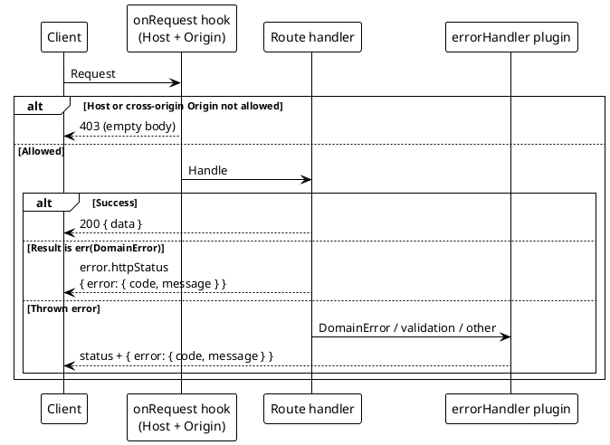
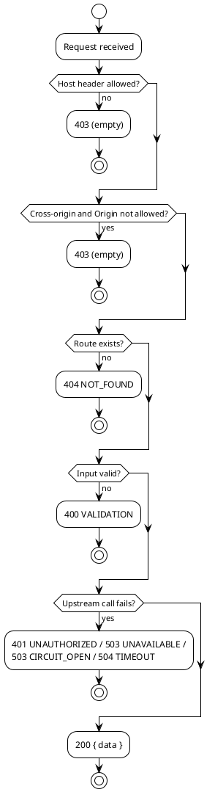

# Error Codes

> [!abstract] Overview
> Error responses and HTTP status codes used by the Watchman backend. Sources: `apps/backend/src/core/errors.ts` (domain errors) and `apps/backend/src/transport/http/plugins/errorHandler.ts` (Fastify error and not-found handlers).

## Error Response Format

Every JSON error uses one envelope (the `DomainError` schema in `apps/backend/openapi.yaml`):

```json
{
  "error": {
    "code": "UNAVAILABLE",
    "message": "Human-readable detail"
  }
}
```

## Domain Error Codes

| Code           | HTTP status | Class               | Typical cause                                                         |
| -------------- | ----------- | ------------------- | --------------------------------------------------------------------- |
| `NOT_FOUND`    | `404`       | `NotFoundError`     | Unknown kind, instance, config id, or profile; unknown route          |
| `VALIDATION`   | `400`       | `ValidationError`   | Request body or parameters fail validation (also Fastify validation)  |
| `UNAUTHORIZED` | `401`       | `UnauthorizedError` | A monitored service rejected Watchman's credentials, or a cert pin mismatch |
| `UNAVAILABLE`  | `503`       | `UnavailableError`  | The monitored service could not be reached or returned an error       |
| `CIRCUIT_OPEN` | `503`       | `CircuitOpenError`  | The per-instance circuit breaker is open after repeated failures (not used when the last failure was `UNAUTHORIZED`/`VALIDATION`; that error is returned instead) |
| `TIMEOUT`      | `504`       | `TimeoutError`      | The upstream call exceeded its timeout                                |
| `INTERNAL`     | `500` (or Fastify status) | —     | Unhandled error; message is `internal error` for `500`                |

`UNAUTHORIZED` never refers to the Watchman API itself. Watchman has no login, protected routes, CSRF tokens, or rate limiting (see [[docs/adr/017-remove-authentication-frontend-v2-migration|ADR-017]]).

## Responses Without a JSON Body

| Condition                                                     | Status | Body  |
| ------------------------------------------------------------- | ------ | ----- |
| `Host` header not allowed (DNS-rebinding guard)               | `403`  | Empty |
| Cross-origin request from an origin not in the allow-list     | `403`  | Empty |
| CORS preflight (`OPTIONS`)                                    | `204`  | Empty |

WebSocket upgrades from a disallowed origin are closed with code `1008` (`origin_not_allowed`). A client address over the connection cap is closed with code `1013`.

## Health Is Not an Error

`GET /services/{kind}/health` normally returns `200` with a snapshot even when the service is down. Reachability is reported in the snapshot (`reachable`, `host`, `service`), not as an HTTP error. The spec also allows `404` (unknown kind or instance) and `503` (`UNAVAILABLE` or `CIRCUIT_OPEN`). See [[docs/api/services-health|Services Health]].

## Related

- [[docs/api/index|API Documentation]]
- [[docs/security/index|Security]]
- [[docs/reference/openapi-spec|OpenAPI Spec]]

## PlantUML Diagrams

### Error Response Flow



### Error Code Decision Tree


