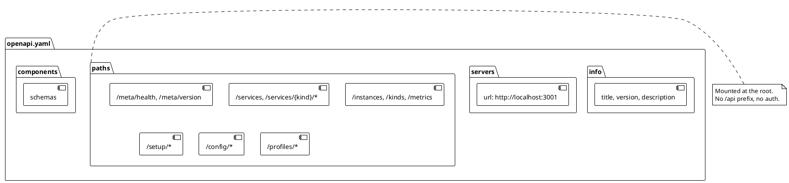
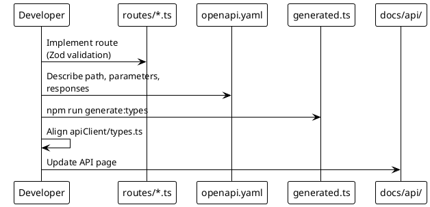

# OpenAPI Specification

> [!abstract] Overview
> Watchman documents its REST API in **OpenAPI 3.1** (`openapi: 3.1.0`). The YAML file is the API source of truth. This reference explains how to read the spec, generate types from it, and extend it when adding endpoints.

## Spec Location

| File               | Path                                       | Description                                   |
| ------------------ | ------------------------------------------ | --------------------------------------------- |
| **Main Spec**      | [[apps/backend/openapi.yaml]]              | Complete OpenAPI 3.1 specification            |
| **Generated types** | `apps/frontend/src/types/generated.ts`    | Output of `npm run generate:types`            |
| **Client types**   | `apps/frontend/src/services/apiClient/types.ts` | Hand-maintained; keep aligned with the spec |

## No Interactive Documentation

The backend does **not** serve a Swagger UI or any `/api/docs` route. Open `apps/backend/openapi.yaml` in an OpenAPI-aware editor or viewer, or load it into a local tool of your choice.

## Spec Structure

```yaml
openapi: 3.1.0
info: # Title, description, version
servers:
  - url: http://localhost:3001
tags: [meta, services, instances, metrics, config, setup]
paths: # Routes are mounted at the root; there is no /api prefix
  /meta/health: ...
  /services/{kind}/health: ...
components:
  schemas: # DomainError, HostHealth, Kind, Instance, ...
```

There is no `securitySchemes` section. Watchman has no authentication (see [[docs/adr/017-remove-authentication-frontend-v2-migration|ADR-017]]).

### Current Paths

| Prefix        | Paths                                                                                                                                                         |
| ------------- | ------------------------------------------------------------------------------------------------------------------------------------------------------------- |
| `/meta`       | `/meta/health`, `/meta/version`                                                                                                                               |
| `/services`   | `/services`, `/services/{kind}/health`, `/services/{kind}/stats`, `/services/{kind}/control`                                                                  |
| `/instances`  | `/instances`, `/instances/{kind}`                                                                                                                             |
| `/kinds`      | `/kinds`                                                                                                                                                      |
| `/metrics`    | `/metrics`                                                                                                                                                    |
| `/setup`      | `/setup/status`, `/setup/philips-bridge/pair`                                                                                                                 |
| `/config`     | `/config/kinds`, `/config/load-errors`, `/config/services`, `/config/services/{id}`, `/config/services/{id}/test`, `/config/services/{id}/profile`, `/config/audit`, `/config/export`, `/config/import` |
| `/profiles`   | `/profiles`, `/profiles/active`, `/profiles/settings`, `/profiles/current-network`, `/profiles/{id}`, `/profiles/{id}/capture-network`                         |

The WebSocket endpoint `/ws` is not described in the spec. See [[docs/features/real-time-updates|Real-Time Updates]].

## Reading the Spec

### Operation Object

```yaml
/meta/health:
  get:
    tags: [meta]
    summary: Liveness probe
    responses:
      "200":
        description: Service is alive
        content:
          application/json:
            schema:
              type: object
              required: [ok, service, uptime, timestamp]
```

### Per-Instance Paths

Service routes take the kind as a path parameter and the instance as an optional `instance` query parameter, through shared parameter components:

```yaml
/services/{kind}/health:
  get:
    parameters:
      - $ref: "#/components/parameters/Kind"
      - $ref: "#/components/parameters/Instance"
```

### Error Responses

Errors use the `DomainError` envelope:

```yaml
DomainError:
  type: object
  required: [error]
  properties:
    error:
      type: object
      required: [code, message]
      properties:
        code:
          type: string
          enum: [NOT_FOUND, UNAVAILABLE, UNAUTHORIZED, TIMEOUT, CIRCUIT_OPEN, VALIDATION]
        message: { type: string }
```

Most successful responses are wrapped as `{ "data": ... }`. Exceptions include `/meta/*`, `/metrics`, and the `/config/export` download bundle; check each path in the spec.

## Changing the API

1. Implement the route under `apps/backend/src/transport/http/routes/` with server-side Zod validation.
2. Update `apps/backend/openapi.yaml` in the same change.
3. Run `npm run generate:types` and align `apps/frontend/src/services/apiClient/types.ts`.
4. If you add a new top-level prefix, add it to `BACKEND_PREFIXES` in `apps/frontend/vite.config.ts` and to the reverse proxy example in [[docs/guides/deployment|Deployment Guide]].
5. Update the matching page in `docs/api/` and state compatibility.

A new service kind does not need new paths; see [[docs/guides/adding-services|Adding Services Guide]].

## Tools

```bash
# Generate frontend types from the spec
npm run generate:types

# Optional: lint the spec with a third-party CLI (not a project dependency)
npx @redocly/cli lint apps/backend/openapi.yaml
```

## Related

- [[docs/api/index|API Documentation]]
- [[apps/backend/openapi.yaml|OpenAPI Spec (Code)]]
- [[docs/reference/error-codes|Error Codes]]
- [[docs/guides/adding-services|Adding Services Guide]]

## PlantUML Diagrams

### OpenAPI Spec Structure



### Spec to Code and Documentation Flow


