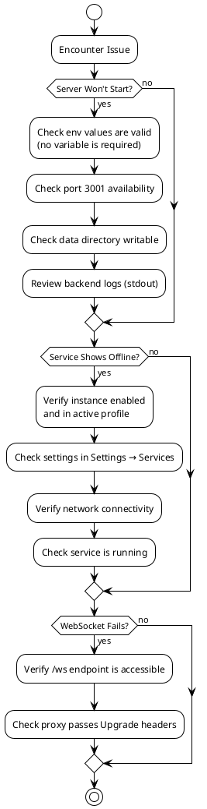
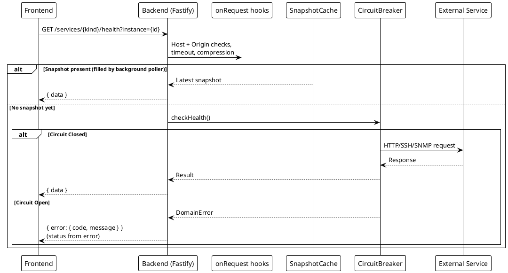

# Troubleshooting

> [!abstract] Purpose
> Common issues and their solutions for Watchman development and deployment.

## Backend Issues

### Server Won't Start

**Symptom**: Process exits immediately with error.

**Solutions**:

- Check the env file values are valid (`apps/backend/.env.local`, or the `.env` fallback; see `.env.example`). An invalid value stops startup with `Invalid environment`. No variable is required.
- Check port 3001 is not in use: `lsof -i :3001`
- Check `DATA_DIR` is writable and, if present, `{DATA_DIR}/master.key` is not empty
- Review the backend logs (stdout of the backend process)
- Verify Node.js version is 22+: `node --version`

### Service Shows Offline

**Symptom**: Service card displays "offline" status.

**Solutions**:

- Verify the instance is enabled and belongs to the active profile (**Settings → Services**, **Settings → Profiles**)
- Check its connection settings and credentials in **Settings → Services**
- Check `GET /config/load-errors` for instances that failed to start
- Verify network connectivity to service host
- Check service is running and accessible
- Review backend logs for connection errors

### CORS or 403 Errors

**Symptom**: Frontend requests succeed in development but fail with `403` or CORS errors in a LAN deployment.

**Solutions**:

- Add the origin users open in the browser to `CORS_ALLOWED_ORIGINS` (for example `https://watchman.your-domain.example`)
- The backend also rejects unknown `Host` headers (DNS-rebinding guard). Host names reached through DNS must appear in `CORS_ALLOWED_ORIGINS`, unless they are loopback, an IP literal, or this machine's hostname
- Check for trailing slashes or protocol mismatches
- Watchman is single-user with no authentication; security relies on network isolation (see [[docs/adr/017-remove-authentication-frontend-v2-migration|ADR-017]])

## Frontend Issues

### Dashboard Doesn't Load

**Symptom**: Blank page or loading spinner.

**Solutions**:

- Check browser console for errors
- Verify backend is running on port 3001
- Check network tab for failed API requests
- Verify WebSocket connection is established

### Service Cards Not Rendering

**Symptom**: Some service cards missing from dashboard.

**Solutions**:

- Check which instances are running: `GET /instances`
- Check the configured services: `GET /config/services`
- Verify the instance is enabled and in the active profile

## Deployment Issues

### Production Startup Fails

**Symptom**: Server exits in production mode.

**Solutions**:

- Verify `NODE_ENV=production`
- Ensure `CORS_ALLOWED_ORIGINS` contains the actual deployment origin
- Check env values are valid (see `apps/backend/.env.example`)
- Verify data directory is writable: `ls -la "$DATA_DIR"` (default `apps/backend/data`)

### WebSocket Connection Fails

**Symptom**: Real-time updates not working.

**Solutions**:

- Verify Nginx proxies `/ws` (not `/api/ws`) and passes WebSocket upgrade headers
- Check Nginx config has `proxy_set_header Upgrade $http_upgrade`
- Check the page origin is allowed (`CORS_ALLOWED_ORIGINS`); a disallowed origin is closed with code `1008`
- Behind a proxy, set `TRUST_PROXY=true`, otherwise all browsers share the 10-connection limit of the proxy address
- Verify no firewall blocking WebSocket connections

## Development Workflow Issues

### `npm run generate:types` Fails

**Symptom**: `openapi-typescript apps/backend/openapi.yaml` command fails with `$ref` resolution errors.

**Cause**: The `openapi.yaml` spec contains unresolvable `$ref` pointers, most commonly in Philips Bridge pairing endpoints.

**Solution**:

- Fix referenced schema definitions in `apps/backend/openapi.yaml` to ensure all `$ref` paths point to valid `#/components/schemas/` definitions
- Verify no circular or external references that the generator cannot resolve
- Once fixed, `npm run generate:types` will generate `apps/frontend/src/types/generated.ts` for frontend TypeScript sync

**Future CI**:

A Vision-style `verify-generated` CI job will be added once the spec is fixed, to ensure generated types remain in sync with the spec on every commit.

## Performance Issues

### Slow Response Times

**Solutions**:

- Check external service response times
- Verify caching is working (per-instance `cacheTtlMs`, default 10 s; health is served from the background poller's latest snapshot)
- Check circuit breaker isn't causing delays
- Review performance monitor logs

### High Memory Usage

**Solutions**:

- Check cache size (in-memory, unbounded)
- Monitor WebSocket connection count
- Consider Redis for shared caching in multi-instance

## Related

- [[docs/common-tasks.md|Common Tasks]]
- [[docs/guides/setup|Setup Guide]]
- [[docs/guides/deployment|Deployment Guide]]

## PlantUML Diagrams

### Debug Flowchart

### Request Flow for Debugging

